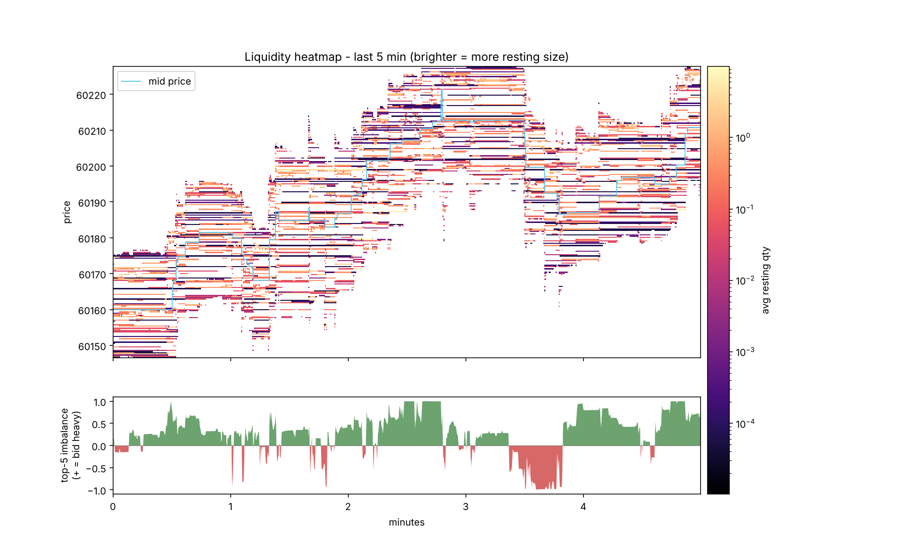
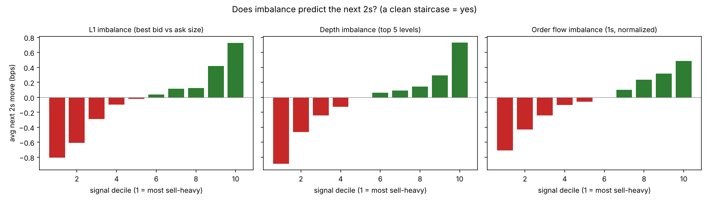
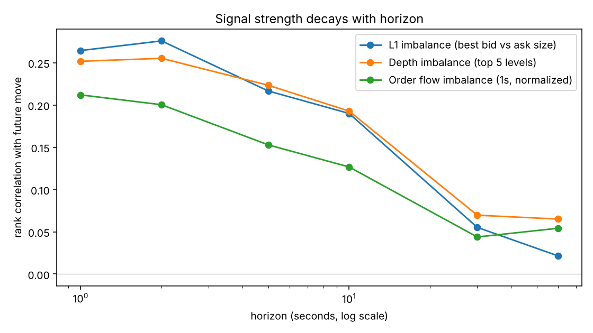

# Order Book Imbalance Predictor

**[▶ Live demo](https://rntrades.github.io/order-book-imbalance/)** - real-time BTC/USD order book heatmap and paper predictions, running in your browser.



Streams a live BTC/USD order book from Kraken's free public websocket, measures how lopsided buyers vs sellers are, and tests whether that imbalance predicts the next price move, including after spread and fees.

## Results (21 hours of BTC/USD, 3 sessions, ~258k samples)

| Session | Length | Notes |
|---|---|---|
| Fri night (ET) | 3.0 h | clean |
| Sat morning | 1.3 h | feed froze near the end -> led to the watchdog fix |
| Sat evening | 3.0 h | clean, recorded with watchdog (1 auto-reconnect) |



**1. The signal is real.** Top-5 depth imbalance has a rank correlation of ~0.25 with the next 1-2s mid-price move across all data (t-stat ~30-40 on non-overlapping samples). Signal deciles form a clean monotonic staircase in every session.

**2. It is short-lived.** Predictive power peaks at 1-5 seconds and is statistically gone by 30-60 seconds.



**3. Direction replicates across sessions; magnitude does not.**

| Top-5 imbalance, 2s ahead | Fri night | Sat evening |
|---|---|---|
| Rank correlation (non-overlap) | 0.22 | 0.32 |
| Hit rate (non-flat moves) | 59% | 72% |

The signal was *stronger* in the thinner Saturday-evening market, where imbalances persist longer. But a linear model fit on earlier sessions mis-sizes the moves in later ones (out-of-sample R^2 turns negative on the combined set at 1s), so the direction is robust while the size of the move depends on market conditions.

**4. Depth beats L1.** Top-5 imbalance was the most stable signal across sessions; simple best-bid/ask imbalance was close; order-flow imbalance (OFI) was weaker throughout.

**5. It does not make money for a retail trader.** Trading only the strongest 10% of signals captures ~0.5-1.5 bps per trade before costs. The analysis assumed a 40 bps (0.40%) taker fee per side; Kraken Pro's actual entry-tier spot taker fee is 0.80%, so real costs are about double that. Even Kraken's entry-tier futures taker fee (0.05% = 5 bps per side) is ~5x the edge. The break-even fee is well under 1 bp per side, a level only market makers with rebates and low latency get. The live dashboard confirmed this in real time: 1,148 paper predictions, 77.5% hit rate on non-flat moves, +0.21 bps average gross, deeply negative after fees.

**Conclusion:** order book imbalance reliably predicts the next few seconds of price, but the edge is far smaller than the cost of trading it. It's useful as an input (e.g. timing entries for a strategy with a larger edge), not as a standalone strategy.

**Limitations:** one exchange, one asset, ~6 clean hours, all Friday night to Saturday, mid-price only (no simulated queue position or partial fills).

## Setup
```
pip install -r requirements.txt
```

## Run
1. Record (2+ hours; Ctrl+C stops early and keeps data):
   ```
   caffeinate -i python3 recorder.py --minutes 180
   ```
   A watchdog stops saving and reconnects if the feed goes quiet.
2. Analyze all sessions in `data/`:
   ```
   python3 analyze.py
   ```
   Outputs `results/report.md`, `heatmap.png`, `deciles.png`, `ic_by_horizon.png`.
3. Live dashboard (paper predictions, logged to `logs/`):
   ```
   python3 live.py
   ```

## Method
- **Signals:** L1 imbalance, top-5 depth imbalance, 1s order flow imbalance (Cont, Kukanov & Stoikov, 2014)
- **Horizons:** 1, 2, 5, 10, 30, 60 seconds
- **Honest stats:** non-overlapping samples for t-stats, train on first 70% / test on last 30% by time, no jumping across recording gaps
- **Cost test:** strongest 10% of signals (threshold set on training data), cross the spread, pay taker fees both ways
